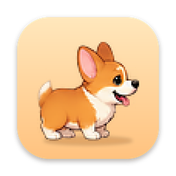
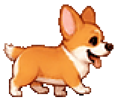
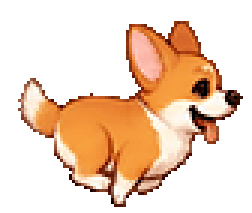
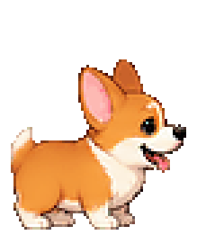
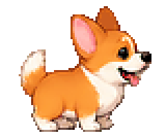
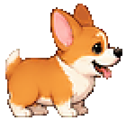
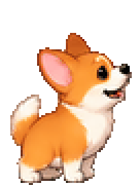
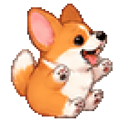
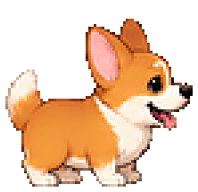

<div align="center">



# eCorgi

**Корги, который живёт на вашем рабочем столе.**

Гуляет по нижнему краю экрана и по окнам, спит, скачет, удирает от курсора
и даётся в руки. Маленькое приложение для macOS по мотивам старого доброго eSheep.







</div>

---

## Что он умеет

| | |
|---|---|
|  | **Просто живёт.** Стоит, моргает, гуляет туда-сюда, присаживается отдохнуть. Что делать дальше, решает сам — по таблице вероятностей. |
|  | **Лазает по окнам.** Подходит к боковой грани переднего окна, забирается наверх, гуляет по заголовку, может свеситься с края или спрыгнуть вниз. |
|  | **Боится курсора.** Подведёте мышь слишком близко — убежит. Спящего мышь не будит. |
|  | **Даётся в руки.** Корги можно взять мышью, перенести и бросить — он упадёт на ближайшую опору и встанет. |
|  | **Устаёт и спит.** Набегав две минуты, укладывается, спит, потом потягивается и встаёт. Может задремать и от скуки. |

Корги не мешает работать: клики по пустому месту вокруг него проходят сквозь
окно в приложение под ним, фокус он не перехватывает, а в Dock его нет.

## Установка

Готовой сборки пока нет — приложение собирается из исходников одной командой.
Нужен macOS 13 или новее и Xcode (или Command Line Tools) со Swift 5.10+.

```bash
git clone https://github.com/SpaceCadet0/eCorgi.git
```

```bash
cd eCorgi && scripts/run.sh release
```

Скрипт соберёт `build/eCorgi.app` и запустит его. Дальше приложение можно
перетащить в «Программы» и запускать как обычно.

## Как им управлять

Всё управление — в меню под значком лапки 🐾 в строке меню. То же меню
открывается правым щелчком по самому корги.

| Пункт | Что делает |
|---|---|
| *строка наверху* | Чем корги занят сейчас и сколько в нём бодрости |
| **Позвать к курсору** | Корги появляется под курсором и падает на ближайшую опору |
| **Уложить спать / Разбудить** | Отправляет спать или будит — плавно, через укладывание и потягивание |
| **Спрятать корги** | Убирает с экрана. Спрятанный корги не тратит ресурсы совсем |
| **Проверка анимаций** | Показывает любую анимацию на месте — удобно при работе над кадрами |
| **Настройки…** | Темп, размер, характер, автозапуск |

Мышью: левая кнопка — взять и перенести, правая — меню.

### Настройки

- **Темп** — скорость движения и анимации, от 0.5× до 2×.
- **Размер** — от 0.5× до 2×. Резче всего корги выглядит при 1× и 2×: кадры
  тогда увеличиваются ровно в целое число раз, без сглаживания.
- **Убегать от курсора** и **Гулять по окнам** — можно выключить, и корги
  останется спокойным жителем нижнего края экрана.
- **Запускать при входе в систему.**

## Сколько он ест

Почти ничего. Замеры на Apple Silicon, релизная сборка, доля одного ядра:

| Чем занят | CPU |
|---|---:|
| Стоит, сидит, спит | 0.2–0.4% |
| Идёт, скачет | около 1.5% |

Памяти — 20–35 МБ.

Так получается потому, что кадр показывается записью в свойство слоя, а не
перерисовкой; частота тиков подстраивается под то, чем корги занят (спящему
хватает десяти в секунду); а список окон опрашивается в фоне и тем реже, чем
спокойнее питомец.

## Анимации

Все кадры — PNG 84×106 с прозрачностью, нарисованы мордой вправо; влево
движок отражает сам. Лежат в
[`Sources/eCorgiKit/Resources/Sprites`](Sources/eCorgiKit/Resources/Sprites)
и называются `<действие>_<номер>.png`.

| Поведение | Кадры | Сколько | Темп | Как играется |
|---|---|---:|---:|---|
| Стоит | `idle` | 29 | 12 | по кругу |
| Идёт | `walk` | 11 | 12 | по кругу |
| Убегает от курсора | `run` | 12 | 12 | по кругу |
| Присел | `sit` | 22 | 7 | один раз целиком: сел, огляделся, встал |
| Укладывается | `sit_down` | 9 | 8 | один раз |
| Спит | `sleep` | 12 | 2.5 | по кругу |
| Просыпается | `stand_up` | 9 | 8 | один раз |
| Скачет | `hop` | 30 | 12 | один раз, ровно на время полёта |
| Спрыгивает с окна | `jump` | 15 | 12 | один раз |
| Падает | `fall` | 8 | 10 | один раз, замирает на последнем кадре |
| Приземляется | `land` | 13 | 12 | один раз |
| Лезет по окну | `climb` | 5 | 8 | вступление, дальше два последних кадра по кругу |
| Висит на краю | `hang` | 2 | 6 | по кругу, плюс покачивание |
| В руках | `drag` | 2 | 8 | по кругу |

Если кадров какого-то действия нет, движок подставит ближайшее по смыслу
(например, вместо `hop` — `jump`), так что пак можно собирать по частям.
В подменю «Проверка анимаций» видно, своими ли кадрами показывается каждое
поведение.

**Чего пока не хватает.** У «чешется» (`scratch`) и «лает» (`bark`) своих
кадров нет, поэтому в обычной жизни корги этого не делает. У `drag` нет
вступления «подхватили», у `climb` и `hang` мало кадров — движение там
дорисовывает покачивание.

<details>
<summary><b>Как добавить или заменить кадры</b></summary>

<br>

- Холст у всех кадров один — 84×106. Корги стоит внизу по центру: по этой
  точке движок ставит его на опору.
- Номер кадра — всё, что после последнего `_`: `sit_down_02.png` — это
  действие `sit_down`, кадр 2.
- Не смешивайте `walk_0.png` и `walk_00.png` в одном действии — порядок
  кадров станет непредсказуемым.
- Файл с незнакомым именем в анимацию не попадёт; приложение напишет о нём
  в лог при запуске.

Кадры — растр, и любая правка необратима, поэтому инструменты в
[`scripts/sprites`](scripts/sprites) сначала кладут копию пака в
`sprite-backups/` и умеют `--dry-run`. Среди них: разбор спрайт-листа на
кадры, посадка на линию земли, выравнивание масштаба между действиями,
промежуточные кадры и приведение гаммы одного действия к другому без потери
резкости. Подробности — в [`scripts/sprites/README.md`](scripts/sprites/README.md).

</details>

## Характер

Привычки корги описаны в одном файле —
[`behaviors.json`](Sources/eCorgiKit/Resources/behaviors.json). В нём две
части: `states` — из какого состояния в какое он переходит и с каким весом,
и `tuning` — числа. Менять можно без правки кода; пропущенные ключи берутся
по умолчанию.

| Ключ | Что меняет |
|---|---|
| `walkSpeed`, `runSpeed`, `climbSpeed` | скорость ходьбы, бега и подъёма, пунктов в секунду |
| `cursorFleeRadius`, `cursorCalmRadius` | с какого расстояния пугается курсора и на каком успокаивается |
| `sleepAfterActivity` | сколько секунд беготни до сна (120) |
| `hopHeight`, `hopLengths`, `hopFPS` | высота, дальность и темп подскока |
| `jumpSpeed`, `jumpLift` | разгон и подброс при спрыгивании с окна |
| `climbChance`, `seekWallChance` | как охотно лезет на окна и идёт к ним специально |
| `edgeHangChance`, `edgeJumpDownChance` | что делает на краю окна: виснет, прыгает или разворачивается |
| `windowStayLimit` | сколько секунд готов провести на окне, прежде чем начнёт спускаться |

<details>
<summary><b>Про сон</b></summary>

<br>

Корги засыпает по двум причинам. **От усталости** — когда наберёт
`sleepAfterActivity` секунд активной жизни (стоять и сидеть не считается).
**От скуки** — если долго не двигался. Счётчик усталости обнуляет только
первый вид сна.

Сон всегда идёт через укладывание и заканчивается потягиванием. Курсор
спящего не трогает; разбудить можно, взяв в руки или через меню. Заснуть
на весу — на грани окна, в прыжке, в руках — корги не может.

</details>

<details>
<summary><b>Про прыжки</b></summary>

<br>

Оба прыжка — честная баллистика: толчок, дальше только гравитация.

**Подскок** длится ровно один проход анимации: из высоты и числа кадров
выводятся скорость толчка и собственная гравитация, поэтому анимация всегда
совпадает с полётом — при любой высоте и любом темпе в настройках.

**Спрыгивание с окна** — толчок наружу и вверх с фиксированной скоростью.
Нижнее окно можно и перелететь: приземление ловится на любой опоре по пути.
Если наружу от края нет места на экране, корги не прыгает, а разворачивается.

</details>

<details>
<summary><b>Как корги видит окна</b></summary>

<br>

Он имеет дело только с **передним окном активного приложения**: оно ничем
не закрыто, и его края гарантированно видны. Верх окна становится полкой,
боковые стороны — стенками, по которым можно лезть.

Опорой становится только то, что видно на экране: кромка под строкой меню
или за Dock не считается, окно во весь экран считается фоном, а грань,
прижатая к краю экрана, отбрасывается.

Если окно закрыли или убрали на задний план, полка исчезает и корги падает —
это правильнее, чем стоять в воздухе. Пока он наверху или в полёте, окна
опрашиваются каждые 0.15 с, на полу — раз в 0.5–1.5 с.

</details>

## Для разработчиков

```bash
swift test
```

```bash
scripts/run.sh
```

```bash
ECORGI_DEBUG=1 .build/debug/eCorgi
```

- `swift test` — 163 теста движка: автомат поведений, физика, прыжки,
  лазание, усталость, разбор окон, темп анимаций.
- `scripts/run.sh [debug|release]` — пересобрать и перезапустить приложение;
  `scripts/build_app.sh` — только собрать `build/eCorgi.app`.
- `ECORGI_DEBUG=1` печатает раз в секунду, чем корги занят и на чём стоит;
  `ECORGI_DEBUG=2` добавляет разбор окон: что отдала система и что из этого
  стало полками.

Зависимостей нет — только AppKit, SwiftUI для окна настроек и Swift Package
Manager.

```
Sources/eCorgiKit/
├── App/         запуск, окно питомца, меню в строке меню
├── Engine/      Pet — «режиссёр», игровой цикл, физика, окна, курсор
├── Behavior/    автомат состояний и сами состояния (States/)
├── Rendering/   загрузка кадров, аниматор, отрисовка
├── Settings/    настройки и их окно
└── Resources/   кадры и behaviors.json
Sources/eCorgi/  main.swift — тонкая обёртка, вся логика в библиотеке
```

На каждом тике `Pet` сначала разбирается с тем, что важнее любого поведения —
схватили мышью, пропала опора, рядом курсор, пора спать, — и только потом
отдаёт управление текущему состоянию. Каждое состояние — маленький класс в
`Behavior/States`, который знает свою анимацию и то, когда ему пора
закончиться.

## Что дальше

- [ ] Свои кадры для «чешется» и «лает», вступление для «в руках»
- [ ] Перепрыгивание с окна на окно
- [ ] Звуки
- [ ] Подписанная сборка, которую можно просто скачать

План и история решений — в [PLAN.md](PLAN.md), чек-лист ручной проверки —
в [QA-checklist.md](QA-checklist.md).

---

<div align="center">

<br>
<sub>По мотивам eSheep — овечки, гулявшей по окнам Windows в девяностых.</sub>
</div>
